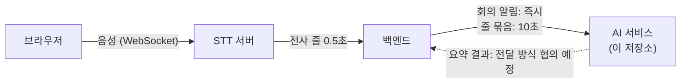

# nineouting-ai-service

AI 회의 중재 어시스턴트의 **AI 서비스**. 백엔드가 보내는 회의 전사 줄을 받아 회의 요약을 만들고, 이후 안건 분류·안건별 요약·안건 상태 판정으로 확장한다.

- 언어와 프레임워크: Python, FastAPI
- 이 저장소의 역할: 전사 입력 수신, 요약 생성, (예정) 안건 기능
- 이 저장소가 하지 않는 것: 음성 인식(STT 서버), 회의·사용자 데이터 저장(백엔드), 배포 설정(클라우드)

## 서비스 안에서의 위치



- 백엔드가 AI 서비스로 **밀어 주는(push)** 방식이다. 요청은 받는 즉시 응답하고, 요약은 뒤에서 처리한다.
- 요약 결과를 백엔드로 돌려주는 방식은 아직 정하지 않았다 (점선).

## 현재 상태

| 기능 | 상태 | 설명 |
|---|---|---|
| 전사 입력 수신 | 구현 | 회의 알림(시작·멈춤·재개·종료)과 줄 묶음을 받는 FastAPI 서버 |
| 입력 변환 | 구현 | 백엔드 형식(camelCase)을 요약 코드 내부 형식으로 변환 |
| 끝난 회의 요약 | 구현, 1차 평가 완료 | 회의가 끝난 뒤 전사 전체를 요약 |
| 회의 중 주기 요약 | 구현, 1차 평가 완료 | 회의 중 2분 구간을 1분마다 갱신 |
| 요약 결과 전달 | 미정 | 백엔드와 방식 협의 예정 |
| Bedrock 호출 | 미구현 | 리전·모델 ID 확인 후 추가 |
| 안건 분류·안건별 요약·안건 상태 판정 | 미구현 | PRD AI-02 ~ AI-04 |

현재 LLM은 기본값이 `echo`(모델을 부르지 않는 테스트용)이고, 실제 요약은 Gemini로 시험했다.

## 폴더 구조

| 경로 | 내용 |
|---|---|
| `server/` | 수신 서버. `main.py`는 주소, `service.py`는 회의별 상태·중복 처리, `selftest.py`는 자체 시험 |
| `summary/meeting_summary.py` | 끝난 회의 요약 |
| `summary/meeting_live_summary_v2.py` | 회의 중 주기 요약 |
| `summary/input_adapter.py` | 입력 변환 |
| `docs/api/input-contract.md` | **백엔드 → AI 서비스 입력 형식** (필드, 규칙, 협의 상태) |
| `examples/api/` | 입력 형식 예시 JSON |
| `Dockerfile`, `requirements.txt`, `.env.example` | 실행·배포용 |

## 다른 팀이 알아야 할 것

### 백엔드

- 입력 형식은 `docs/api/input-contract.md`를 기준으로 한다. 예시는 `examples/api/`에 있다.
- 현재 받는 주소는 임시이다.

| 용도 | 주소 |
|---|---|
| 회의 알림 | `POST /internal/meetings/{meetingId}/events` |
| 줄 묶음 | `POST /internal/meetings/{meetingId}/batches` |
| 수신 현황 (전사 내용 없음) | `GET /internal/meetings/{meetingId}/status` |
| 상태 확인 | `GET /health` |

- 정상 접수는 `200` + `{"accepted": true}`, 형식 오류와 주소·본문의 `meetingId` 불일치는 `400` + `{"error": "INVALID_INPUT"}`로 응답한다. 자세한 응답은 입력 형식 문서 7장에 있다.
- 같은 `batch` 번호를 다시 보내면 무시한다. `end` 알림 뒤에 도착한 줄 묶음도 무시하므로, 마지막 줄 묶음을 먼저 보낸 뒤 `end`를 보낸다.

### 클라우드

- 이미지는 `Dockerfile`로 만들고 포트는 `8000`이다. 배포 설정은 클라우드 팀이 맡는다.
- 설정은 환경변수로 주입한다 (아래 표). 비밀키는 이미지에 넣지 않는다.
- CPU·메모리 요구량은 측정 전이다.

| 환경변수 | 설명 | 기본값 |
|---|---|---|
| `LLM_PROVIDER` | `echo`, `gemini`, `anthropic`, `openai` | `echo` |
| `LLM_MODEL` | 모델 이름 | 없음 |
| `WINDOW_SEC` | 요약 구간 길이(초) | 120 |
| `REFRESH_SEC` | 구간 갱신 주기(초) | 60 |
| `MAX_CALLS_PER_MEETING` | 회의당 모델 호출 상한 | 60 |
| `LOG_LEVEL` | 로그 수준 | `INFO` |
| `GEMINI_API_KEY` | `LLM_PROVIDER=gemini`일 때만 필요 | 없음 |

### 로그와 개인정보

- 로그와 상태 조회에는 전사 내용을 남기지 않는다. 회의 번호, 묶음 번호, 개수, 예외 이름만 남긴다.

## 실행과 시험

모델을 호출하지 않으므로 비용이 들지 않는다.

```bash
# 요약 코드 자체 시험
cd summary
python3 meeting_summary.py --selftest
python3 meeting_live_summary_v2.py --selftest
python3 input_adapter.py
```

```bash
# 수신 서버 (저장소 루트에서)
pip install -r requirements.txt
python3 -m server.selftest
cp .env.example .env
uvicorn server.main:app --port 8000
curl localhost:8000/health
```

```bash
# 예시 요청 보내기
curl -X POST localhost:8000/internal/meetings/m_1234/events \
  -H 'content-type: application/json' -d @examples/api/meeting-event-start.json
curl -X POST localhost:8000/internal/meetings/m_1234/batches \
  -H 'content-type: application/json' -d @examples/api/lines-batch-basic.json
curl localhost:8000/internal/meetings/m_1234/status
```

## 브랜치와 PR 규칙

- `main`: `.gitignore`만 둔다.
- `develop`: 작업 기준 브랜치.
- `feature/*`: 기능 단위로 만들고 `develop`으로 PR을 올린다.
- 커밋 메시지는 `feat:`, `fix:`, `docs:` 접두사에 명사형·평서체로 쓴다.

## 주의

- API 키는 코드나 파일에 쓰지 않고 환경변수로만 설정한다. `.env`는 저장소에 올리지 않는다.
- 전사 파일과 실행 결과에는 개인 대화가 담겨 있으므로 올리지 않는다 (`.gitignore`에 등록되어 있다).
