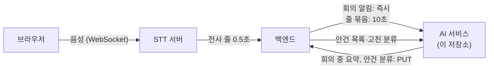

# nineouting-ai-service

AI 회의 중재 어시스턴트의 **AI 서비스**. 백엔드가 보내는 회의 전사 줄을 받아 회의 요약을 만들고, 안건에 줄을 자동 분류한다. 이후 안건별 요약·안건 상태 판정으로 확장한다.

- 언어와 프레임워크: Python, FastAPI
- 이 저장소의 역할: 전사 입력 수신, 요약 생성, 안건 자동 분류, (예정) 안건별 요약·상태 판정
- 이 저장소가 하지 않는 것: 음성 인식(STT 서버), 회의·사용자 데이터 저장(백엔드), 배포 설정(클라우드)

## 서비스 안에서의 위치



- 백엔드가 AI 서비스로 **밀어 주는(push)** 방식이다. 요청은 받는 즉시 응답하고, 요약은 뒤에서 처리한다.
- 회의 중 요약은 AI 서비스가 백엔드로 `PUT`으로 보낸다 (요약이 바뀔 때마다). 형식은 `docs/api/output-contract.md`에 있다.
- 안건 목록(전체)과 사람이 고친 분류는 백엔드가 AI 서비스로 보내고, 줄별 안건 분류 결과는 AI 서비스가 백엔드로 `PUT`한다. 형식은 `docs/api/agenda-contract.md`(v0.1 초안, 백엔드 확인 전)에 있다.
- 안건 보드, 오늘 회의 요약, 회의록 초안, 챗봇은 백엔드와 합의한 연동 API 초안을 따르며 이 저장소에는 아직 없다.

## 현재 상태

| 기능 | 상태 | 설명 |
|---|---|---|
| 전사 입력 수신 | 구현 | 회의 알림(시작·멈춤·재개·종료)과 줄 묶음을 받는 FastAPI 서버 |
| 입력 변환 | 구현 | 백엔드 형식(camelCase)을 요약 코드 내부 형식으로 변환 |
| 끝난 회의 요약 | 구현, 1차 평가 완료 | 회의가 끝난 뒤 전사 전체를 요약 |
| 회의 중 주기 요약 | 구현, 1차 평가 완료 | 회의 중 2분 구간을 1분마다 갱신 |
| 회의 중 요약 전달 | 구현 | 요약이 바뀔 때마다 백엔드로 PUT. 실패하면 재시도 3회 (`BACKEND_BASE_URL`을 설정했을 때) |
| 묶음 번호 확인과 재시작 복구 | 구현 | 번호가 이어지지 않으면 `409` + `expectedBatch`, 백엔드가 그 번호부터 다시 보냄 |
| 토큰 사용량 지표 | 구현 | OpenTelemetry `gen_ai.client.token.usage`, `GET /metrics` |
| Bedrock 호출 | 미구현 | 리전·모델 ID 확인 후 추가 |
| 안건 자동 분류 | 구현, 1차 평가 완료 | 줄마다 안건 하나 또는 해당 없음. 직전 대화와 사람이 고친 예를 함께 보여 줌. 사람이 고친 줄은 고정. 결과는 새로 분류했거나 바뀐 줄만 PUT (`docs/eval/agenda-classification-eval-v1.md`) |
| 안건별 요약 | 구현, 평가 전 | 안건마다 그 안건의 줄만 모아 2~3문장으로 요약하고 문장마다 근거 줄을 붙임. 사람이 고친 문장은 고정하고 근거가 달라지면 "확인 필요" 표시. 안건 보드 전체 상태를 PUT (`docs/api/agenda-summary-contract.md`) |
| 안건 상태 판정 | 구현, 평가 전 | 안건마다 아직 안 다룸·논의 중·결정·미결·결정 확인 필요 중 하나와 근거 줄을 안건 보드에 담음. 줄이 있는 안건만 모델이 결정 여부를 판정하고, 결정에는 근거 줄이 필수 (`docs/api/agenda-status-contract.md`) |
| 안건 보드, 오늘 회의 요약, 회의록 초안, 챗봇 | 미구현 | 연동 API 초안 기준 |

현재 LLM은 기본값이 `echo`(모델을 부르지 않는 테스트용)이고, 실제 요약과 안건 분류는 Gemini로 시험했다.

## 폴더 구조

| 경로 | 내용 |
|---|---|
| `server/` | 수신 서버. `main.py`는 주소, `service.py`는 회의별 상태·묶음 번호 확인, `publisher.py`는 요약 전송, `metrics.py`는 토큰 지표, `selftest.py`는 자체 시험 |
| `summary/meeting_summary.py` | 끝난 회의 요약 |
| `summary/meeting_live_summary_v2.py` | 회의 중 주기 요약 |
| `summary/agenda_classifier.py` | 안건 자동 분류 |
| `summary/eval_agenda.py` | 안건 분류 평가 (기본은 비용 0, 유료 호출은 옵션을 켜야 함) |
| `summary/input_adapter.py` | 입력 변환 (전사 줄, 안건 목록, 고친 분류) |
| `docs/api/input-contract.md` | **백엔드 → AI 서비스 입력 형식** (필드, 규칙, 협의 상태) |
| `docs/api/output-contract.md` | **AI 서비스 → 백엔드 회의 중 요약 형식** |
| `docs/api/agenda-contract.md` | **안건 목록·분류 결과·고친 분류 형식** (v0.1 초안) |
| `docs/eval/` | 평가 결과 |
| `examples/api/` | 입력·출력 형식 예시 JSON |
| `Dockerfile`, `requirements.txt`, `.env.example` | 실행·배포용 |

## 다른 팀이 알아야 할 것

### 백엔드

- 입력 형식은 `docs/api/input-contract.md`를 기준으로 한다. 예시는 `examples/api/`에 있다.
- 현재 받는 주소는 임시이다.

| 용도 | 주소 |
|---|---|
| 회의 알림 | `POST /internal/meetings/{meetingId}/events` |
| 줄 묶음 | `POST /internal/meetings/{meetingId}/batches` |
| 수신 현황 (전사 내용 없음) | `GET /internal/meetings/{meetingId}/status` |
| 안건 목록 전체 (덮어쓰기) | `PUT /internal/meetings/{meetingId}/agendas` |
| 사람이 고친 분류 | `POST /internal/meetings/{meetingId}/agenda-corrections` |
| 사람이 고친 요약 | `POST /internal/meetings/{meetingId}/agenda-summary-edits` |
| 상태 확인 | `GET /health` |

- 응답 (자세한 내용은 입력 형식 문서 7장)

| 상황 | 응답 |
|---|---|
| 정상 접수 | `200` + `{"accepted": true}` |
| `batch` 번호가 이어지지 않음, 재시작해서 모르는 회의 | `409` + `{"expectedBatch": N}`. N번부터 보냈던 그대로 다시 보낸다 |
| 형식 오류, 주소와 본문의 `meetingId` 불일치 | `400` + `{"error": "INVALID_INPUT"}` |
| 아직 받을 수 없음 (종료 중, LLM 설정 누락) | `503`. 10초 뒤 다시 보낸다 |

- `batch` 번호는 1부터 빠짐없이 이어져야 한다. 같은 번호를 다시 보내면 무시한다.
- `end` 알림 뒤에 도착한 줄 묶음은 무시하므로, 마지막 줄 묶음을 먼저 보낸 뒤 `end`를 보낸다.
- 회의 중 요약은 AI 서비스가 `PUT {백엔드 주소}/internal/meetings/{meetingId}/live-summary`로 보낸다 (`docs/api/output-contract.md`).
- 줄별 안건 분류 결과는 `PUT {백엔드 주소}/internal/meetings/{meetingId}/agenda-classification`으로 보낸다. 새로 분류했거나 바뀐 줄만 담고, 회의 종료 뒤에는 `final: true` 결과를 보낸다. 안건 목록이 아직 없으면 줄을 모아 두었다가 목록이 오면 분류한다 (`docs/api/agenda-contract.md`).
- 안건별 요약은 `PUT {백엔드 주소}/internal/meetings/{meetingId}/agenda-board`로 보낸다. 안건 목록의 모든 안건을 담은 전체 상태이고, 담을 값이 바뀌었을 때만 보내며 1초에 한 번보다 자주 보내지 않는다. 가장 큰 `version`이 최신이다 (`docs/api/agenda-summary-contract.md`).
- 일시적 실패(408, 429, 5xx, 연결 오류)는 1, 2, 4초 간격으로 3번 다시 보내고, 그 밖의 4xx는 버린다. 백엔드가 어떤 4xx를 돌려주는지는 연동 때 확인한다.

### 클라우드

- 이미지는 `Dockerfile`로 만들고 포트는 `8000`이다. 배포 설정은 cn 팀이 맡는다.
- 설정은 환경변수로 주입한다 (아래 표). 비밀키는 이미지에 넣지 않는다.
- 토큰 사용량 지표는 `GET /metrics`(Prometheus 형식)로 열려 있고, `OTEL_EXPORTER_OTLP_ENDPOINT`를 설정하면 OTLP로도 보낸다. 작업 종류는 `ai.task` 속성이며 `live_summary`(회의 중 요약), `draft`(끝난 회의 요약), `agenda_classification`(안건 분류) 세 가지다.
- CPU·메모리 요구량은 측정 전이다.

| 환경변수 | 설명 | 기본값 |
|---|---|---|
| `LLM_PROVIDER` | `echo`, `gemini`, `anthropic`, `openai` | `echo` |
| `LLM_MODEL` | 모델 이름 | 없음 |
| `WINDOW_SEC` | 요약 구간 길이(초) | 120 |
| `REFRESH_SEC` | 구간 갱신 주기(초) | 60 |
| `MAX_CALLS_PER_MEETING` | 회의당 모델 호출 상한 | 60 |
| `BACKEND_BASE_URL` | 회의 중 요약을 보낼 백엔드 주소. 비우면 보내지 않음 | 없음 |
| `LIVE_SUMMARY_PATH` | 요약을 보낼 경로 | `/internal/meetings/{meeting_id}/live-summary` |
| `AGENDA_CLASSIFICATION_PATH` | 안건 분류 결과를 보낼 경로 (`BACKEND_BASE_URL`과 같은 주소로) | `/internal/meetings/{meeting_id}/agenda-classification` |
| `CLASSIFY_REFRESH_SEC` | 안건 분류 모델 호출 간격(음성 시간 초) | 30 |
| `MAX_CLASSIFY_CALLS_PER_MEETING` | 회의당 안건 분류 호출 상한 | 200 |
| `AGENDA_BOARD_PATH` | 안건 보드를 보낼 경로 (`BACKEND_BASE_URL`과 같은 주소로) | `/internal/meetings/{meeting_id}/agenda-board` |
| `AGENDA_SUMMARY_REFRESH_SEC` | 안건에 새 줄이 1개뿐일 때 요약을 기다리는 시간(음성 시간 초). 2개 이상이면 바로 요약 | 60 |
| `MAX_AGENDA_SUMMARY_CALLS_PER_MEETING` | 회의당 안건별 요약 호출 상한 (비용을 추정한 뒤 다시 정함) | 300 |
| `AGENDA_STATUS_REFRESH_SEC` | 안건에 새 줄이 1개뿐일 때 상태 판정을 기다리는 시간(음성 시간 초). 2개 이상이면 바로 판정 | 60 |
| `MAX_AGENDA_STATUS_CALLS_PER_MEETING` | 회의당 안건 상태 판정 호출 상한 (비용을 추정한 뒤 다시 정함) | 300 |
| `OTEL_EXPORTER_OTLP_ENDPOINT` | 토큰 지표를 OTLP(HTTP)로도 보낼 주소 | 없음 |
| `LOG_LEVEL` | 로그 수준 | `INFO` |
| `GEMINI_API_KEY` | `LLM_PROVIDER=gemini`일 때 필요. 없으면 `503` | 없음 |

### 로그와 개인정보

- 로그와 상태 조회에는 전사 내용을 남기지 않는다. 회의 번호, 묶음 번호, 개수, 예외 이름만 남긴다.

## 실행과 시험

모델을 호출하지 않으므로 비용이 들지 않는다.

```bash
# 요약 코드 자체 시험
cd summary
python3 meeting_summary.py --selftest
python3 meeting_live_summary_v2.py --selftest
python3 agenda_status.py --selftest
python3 input_adapter.py
```

```bash
# 수신 서버 (저장소 루트에서)
pip install -r requirements.txt
python3 -m server.selftest
cp .env.example .env
uvicorn server.main:app --port 8000
curl localhost:8000/health
```

```bash
# 예시 요청 보내기
curl -X POST localhost:8000/internal/meetings/m_1234/events \
  -H 'content-type: application/json' -d @examples/api/meeting-event-start.json

# 예시 묶음의 번호는 7이라 처음 보내면 409 + {"expectedBatch": 1} 로 답한다
curl -i -X POST localhost:8000/internal/meetings/m_1234/batches \
  -H 'content-type: application/json' -d @examples/api/lines-batch-basic.json

# 번호를 1로 바꿔 보내면 받는다
sed 's/"batch": 7/"batch": 1/' examples/api/lines-batch-basic.json | curl -X POST \
  localhost:8000/internal/meetings/m_1234/batches -H 'content-type: application/json' -d @-

curl localhost:8000/internal/meetings/m_1234/status
curl localhost:8000/metrics
```

## 브랜치와 PR 규칙

- `main`: `.gitignore`만 둔다.
- `develop`: 작업 기준 브랜치.
- `feature/*`: 기능 단위로 만들고 `develop`으로 PR을 올린다.
- 커밋 메시지는 `feat:`, `fix:`, `docs:` 접두사에 명사형·평서체로 쓴다.

## 주의

- API 키는 코드나 파일에 쓰지 않고 환경변수로만 설정한다. `.env`는 저장소에 올리지 않는다.
- 전사 파일과 실행 결과에는 개인 대화가 담겨 있으므로 올리지 않는다 (`.gitignore`에 등록되어 있다).
